# Document Processing Module (`doc-processing`)

An end-to-end document ingestion, cloud storage, and AI-powered extraction pipeline built with **Node.js**, **Express**, **TypeScript**, **AWS S3**, and **Google Gemini 3.8 Flash (VLM)**.

---

## 📋 Table of Contents
- [Architecture & Workflow](#-architecture--workflow)
- [Module Structure](#-module-structure)
- [API Routes Reference](#-api-routes-reference)
  - [`POST /api/docs/process`](#post-apidocsprocess)
  - [`GET /health`](#get-health)
  - [`GET /`](#get-)
- [Pipeline Execution Details](#-pipeline-execution-details)
- [Supported Formats & Limits](#-supported-formats--limits)
- [Configuration & Environment Variables](#-configuration--environment-variables)
- [Quickstart & Testing](#-quickstart--testing)

---

## 🏗️ Architecture & Workflow

The module processes uploaded documents through a strict multi-stage pipeline:

```mermaid
sequenceDiagram
    autonumber
    actor User as Client / Web UI
    participant Server as Express Server
    participant Router as docp.routes.ts (Multer)
    participant Controller as docp.controllers.ts
    participant S3 as AWS S3 (uploads/)
    participant Gemini as Google Gemini VLM (3.8-flash)

    User->>Server: POST /api/docs/process (multipart/form-data)
    Server->>Router: Forward to Upload Middleware
    Router->>Router: Validate MIME type, extension, and file size (<20MB)
    alt Invalid Format or Oversized
        Router-->>User: 400 Bad Request (JSON error)
    else Validation Passed
        Router->>Controller: processDocumentController(req, res)
        Controller->>Controller: Generate unique jobId (UUID)
        
        rect rgb(30, 41, 59)
            Note over Controller,S3: Stage 1: Cloud Storage
            Controller->>S3: Upload file buffer (PutObjectCommand)
            S3-->>Controller: Return S3 URL
        end
        
        rect rgb(30, 41, 59)
            Note over Controller,Gemini: Stage 2: AI Extraction
            alt DOCX Document
                Controller->>Controller: Extract text via Mammoth
                Controller->>Gemini: Text-based analysis prompt
            else PDF or Image (PNG/JPEG/WEBP)
                Controller->>Gemini: Direct binary extraction via Interactions API
            end
            Gemini-->>Controller: Structured extraction output
        end

        rect rgb(30, 41, 59)
            Note over Controller: Stage 3: Logging & Response Dispatch
            Controller->>Controller: logDocumentResult(result) to console
        end

        Controller-->>User: 200 OK (Job status & extraction result)
    end
```



---

## 📁 Module Structure

The document processing module is located under `src/modules/doc-processing/`:

```
doc-processing/
├── public/
│   └── index.html               # Web UI for drag-and-drop document testing
├── src/
│   ├── config/
│   │   └── index.ts             # Central configuration loader for env variables
│   ├── modules/
│   │   └── doc-processing/
│   │       ├── docp.routes.ts   # Route definition, Multer upload & validation middleware
│   │       ├── docp.controllers.ts # Request controller, orchestration, job ID generation
│   │       └── docp.services.ts # S3 upload, Gemini VLM extraction, and console logging
│   ├── types/
│   │   └── mammoth.d.ts         # TypeScript module declaration for mammoth
│   └── index.ts                 # Express application initialization and route mounting
├── .env                         # Local environment variables
├── .env.example                 # Environment template
└── package.json                 # Project dependencies and npm scripts
```

---

## 🔌 API Routes Reference

### `POST /api/docs/process`
Uploads a document, saves it to AWS S3, analyzes it using Google Gemini 3.8 Flash VLM, and returns the structured extraction.

- **URL:** `/api/docs/process`
- **Method:** `POST`
- **Content-Type:** `multipart/form-data`

#### Request Parameters
| Field | Type | Required | Description |
| :--- | :--- | :--- | :--- |
| `file` | `File` (Binary) | **Yes** | The document to be analyzed (PDF, DOCX, or Image). |

#### Validation Constraints
- **Allowed MIME types:** `application/pdf`, `application/vnd.openxmlformats-officedocument.wordprocessingml.document`, `application/msword`, `image/jpeg`, `image/png`, `image/webp`, `image/gif`, `image/tiff`
- **Allowed Extensions:** `.pdf`, `.docx`, `.doc`, `.jpg`, `.jpeg`, `.png`, `.webp`, `.gif`, `.tiff`, `.tif`
- **Max File Size:** `20MB` (default, configurable via `MAX_FILE_SIZE_MB`)

#### Success Response (`200 OK`)
```json
{
  "success": true,
  "jobId": "facb6ce7-85a9-4ed3-8868-1ff233e33eeb",
  "status": "completed",
  "message": "Document successfully processed.",
  "data": {
    "jobId": "facb6ce7-85a9-4ed3-8868-1ff233e33eeb",
    "originalName": "invoice.pdf",
    "mimeType": "application/pdf",
    "sizeBytes": 54200,
    "s3Location": "https://onspotlegaldocsprocessing.s3.us-east-1.amazonaws.com/uploads/facb6ce7-85a9-4ed3-8868-1ff233e33eeb-1792072989463-invoice.pdf",
    "extractedInfo": "### 1. Document Title & Category/Type\n* **Title:** Invoice #10492\n* **Type:** Financial Invoice\n\n### 2. High-level Summary\nInvoice fragment with balance...\n\n### 3. Key Information\n* **Total Amount:** $500\n\n### 4. Full Text Content\nInvoice #10492 - Total: $500\n\n### 5. Tabular Data\n| Field | Value |\n| Invoice Number | #10492 |\n| Total Amount | $500 |",
    "extractedAt": "2026-10-15T14:03:23.903Z"
  }
}
```

#### Error Responses
- **`400 Bad Request`** (Missing or invalid file):
  ```json
  {
    "success": false,
    "error": "Invalid file type: \"sample.txt\". Only PDF, DOCX, and images (JPEG, PNG, WEBP, GIF, TIFF) are supported."
  }
  ```
- **`400 Bad Request`** (Exceeds size limit):
  ```json
  {
    "success": false,
    "error": "File size exceeds the limit of 20MB."
  }
  ```
- **`500 Internal Server Error`** (S3 or Gemini API failure):
  ```json
  {
    "success": false,
    "jobId": "4fe51a5b-1012-4755-9723-f7c1775caee0",
    "status": "failed",
    "error": "Google VLM extraction failed: ..."
  }
  ```

---

### `GET /health`
Liveness probe to confirm that the server is operational.

- **URL:** `/health`
- **Method:** `GET`
- **Response (`200 OK`):**
  ```json
  {
    "status": "ok",
    "timestamp": "2026-10-15T14:03:16.069Z"
  }
  ```

---

### `GET /`
Serves the web client interface from the `public/` directory:
- Drag-and-drop document upload interface.
- Pipeline execution tracker (validation, S3 upload, Gemini extraction, response structuring).
- Formatted Markdown viewer with raw JSON toggle and export options.

---

## ⚙️ Pipeline Execution Details

### 1. File Ingestion & Memory Buffer
Files are received via `multer.memoryStorage()`. Keeping the buffer in memory avoids redundant disk I/O and allows direct streaming to AWS S3 and base64 encoding for Gemini.

### 2. S3 Upload (`uploadToS3`)
- Uses AWS SDK v3 (`@aws-sdk/client-s3`).
- Constructs destination key: `uploads/${jobId}-${Date.now()}-${file.originalname}`.
- Sends `PutObjectCommand` with file buffer and MIME type.
- Returns public S3 HTTPS URL upon completion.

### 3. VLM Document Extraction (`extractWithVLM`)
- Uses Google Gen AI SDK (`@google/genai`) with model **`gemini-3.8-flash`**.
- Powered by the **Interactions API** (`ai.interactions.create`):
  - **PDFs**: Ingested as `{ type: 'document', mime_type: 'application/pdf', data: base64 }`.
  - **Images**: Ingested as `{ type: 'image', mime_type: ..., data: base64 }`.
  - **DOCX**: Pre-extracted using `mammoth.extractRawText()`, then processed via structured prompt.
- Extracts: Title, category, summary, metadata/entities (dates, names, IDs), full transcription, and tables/key-value pairs.

### 4. Console Logging & Response Dispatch (`logDocumentResult`)
- Formats metadata, S3 URL, and extracted text with visual ASCII separators.
- Emits formatted log output to stdout.
- Dispatches HTTP 200 response with structured JSON payload.

---

## 🔒 Configuration & Environment Variables

Create a `.env` file in the project root based on [.env.example](file:///c:/Users/Abhay/OneDrive/Desktop/doc-processing/.env.example):

```ini
PORT=3000
MAX_FILE_SIZE_MB=20

# Google Studio Gemini API Key
GEMINI_API_KEY=your_gemini_api_key_here
GEMINI_MODEL=gemini-3.8-flash

# AWS S3 Configuration
AWS_REGION=us-east-1
AWS_ACCESS_KEY_ID=your_aws_access_key_id
AWS_SECRET_ACCESS_KEY=your_aws_secret_access_key
AWS_S3_BUCKET_NAME=your_s3_bucket_name
```

---

## 🚀 Quickstart & Testing

### 1. Start Server
```powershell
npm run dev
```
The server will start on `http://localhost:3000`.

### 2. Test via Web UI
Open your browser and navigate to:
```
http://localhost:3000
```
Drag and drop any PDF, Word document, or image and click **Upload & Process Document**.

### 3. Test via cURL
```bash
curl -X POST http://localhost:3000/api/docs/process \
  -F "file=@sample_invoice.pdf"
```

### 4. Type Check / Build
```powershell
# Type check without emitting
npx tsc --noEmit

# Compile production bundle to dist/
npm run build
```
